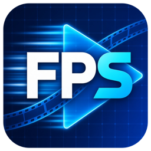

<p align="center"></p>

<h1 align="center">FPS · Fast Presentation Solution</h1>

<p align="center">Convierte videos pesados a un formato seguro para presentaciones, eventos y VJing.<br>Gratis · Mac y Windows · Sin instalar nada más</p>

> ⚠️ **Aviso:** estamos **momentáneamente sin soporte en nuestro hosting**. Por eso el formulario de feedback de la app (menú *Ayuda → Enviar feedback*) todavía no está disponible y el correo puede responder con demora. Mientras lo resolvemos, escríbenos a **contacto@ascensodigital.cl** o por [WhatsApp](https://wa.me/56985314898). ¡Gracias por la paciencia!

---

## ¿Para qué sirve?

Cuando un video 4K, de 60 fps o en un códec muy comprimido (como HEVC) se traba en tu software de mezcla en vivo (GrandVJ XT, Resolume, ProPresenter, etc.), **FPS lo convierte en unos clics** a un archivo liviano y fluido, sin depender de que estés en un evento con mala conexión.

- **FPS Quick:** 1080p · 30 fps · 4 Mbit/s · audio AAC 192 kbps a 44,1 kHz, con un solo botón.
- **Formatos personalizados** (H.264 o Photo JPEG, resolución, fps, bitrate) y presets que se guardan con tu nombre. Incluye una medida para pantallas LED de 1920×384.
- **Proporción bajo control:** barras negras, recortar o estirar, para que un video vertical o 4:3 no salga deformado.
- **Cola de conversión:** arrastras varios videos, los ordenas y se convierten uno tras otro. En Mac puedes pausar uno largo para pasar uno corto de último minuto.
- **Añadir desde enlaces:** pega un enlace público de Google Drive, Dropbox o un enlace directo y FPS lo descarga y lo convierte.
- **Avisa cuando termina** y abre la carpeta con tus videos.

## Descargar

**👉 [Ir a la última versión](../../releases/latest)** y elegir el archivo según tu computador:

| Tu computador | Archivo |
|---|---|
| Mac con chip Apple (M1, M2, M3, M4…) | `FPS-…-mac-arm64.dmg` |
| Mac con procesador Intel | `FPS-…-mac-x64.dmg` |
| Windows 10 u 11 | `FPS-Setup-….exe` |

¿No sabes qué Mac tienes? Menú Apple  → **Acerca de este Mac**: si dice *Chip Apple M…* es arm64; si dice *Procesador Intel…* es x64.

## Instalación

### Mac
1. Abre el `.dmg` y arrastra **FPS** a la carpeta *Aplicaciones*.
2. La primera vez, macOS dirá que no puede verificar al desarrollador (ver más abajo). Haz **clic derecho sobre FPS → Abrir → Abrir**. Solo hace falta una vez.
   - En macOS reciente, si no aparece "Abrir": *Ajustes del Sistema → Privacidad y seguridad →* baja hasta **"Abrir de todos modos"**.

### Windows
1. Ejecuta `FPS-Setup-….exe` (no necesita permisos de administrador).
2. Si aparece *"Windows protegió su PC"*: clic en **Más información → Ejecutar de todas formas**.

### ¿Por qué salen esos avisos?
Esos avisos aparecen con cualquier programa que no tiene la firma de pago de Apple o Microsoft. FPS todavía no la tiene. No significa que el programa haga algo raro, pero si quieres comprobar que el archivo no fue alterado, compara su huella con `SHA256SUMS.txt`:

```bash
shasum -a 256 FPS-…-mac-x64.dmg      # Mac
certutil -hashfile FPS-Setup-….exe SHA256   # Windows (en el Símbolo del sistema)
```

## Cómo se usa

1. **Arrastra tus videos** a la ventana (o usa *+ Añadir Videos* / *🔗 Añadir enlace*).
2. Elige la **carpeta de destino**.
3. Haz clic en los videos que quieras convertir (se marcan en azul) y presiona **Aplicar: FPS Quick** (o *Personalizado*).
4. Presiona **▶ Iniciar Renderizados**. Cuando termina, tu video queda en la carpeta, con el nombre original más `_FPS`.

Tus videos originales **nunca se modifican**.

## Privacidad

FPS convierte todo **en tu propio computador**: tus videos no se suben a ningún servidor y la app no envía estadísticas. Solo se conecta a internet cuando tú pegas un enlace (para descargar ese archivo) o cuando abres la página de feedback.

## Estado de las pruebas

| Sistema | Estado |
|---|---|
| macOS Intel | Probado |
| macOS Apple Silicon | En pruebas |
| Windows 11 | Probado (instalación, descarga desde enlace y conversión) |

## Soporte y contacto

Si algo no funciona o tienes una idea, escríbenos:

- 📧 **contacto@ascensodigital.cl**
- 💬 [WhatsApp](https://wa.me/56985314898)
- 🌐 [ascensodigital.cl](https://ascensodigital.cl)

Actualmente estamos **sin soporte en nuestro hosting de forma momentánea**: el formulario de *Ayuda → Enviar feedback* dentro de la app volverá a estar disponible en cuanto se resuelva, y el correo puede tardar en responder. Si es urgente, WhatsApp es lo más rápido.

Cuéntanos qué sistema usas (Mac Intel, Mac Apple Silicon o Windows), la versión de FPS (la ves en la parte superior de la app) y qué estabas haciendo cuando falló.

## Licencia y créditos

© 2026 [Ascenso Digital](https://ascensodigital.cl). FPS es de uso gratuito.

FPS usa **FFmpeg** (licencia GPL), que viaja dentro de cada instalador como un programa independiente. Los detalles, textos de licencia y dónde obtener su código fuente están en [THIRD-PARTY-NOTICES.md](THIRD-PARTY-NOTICES.md).
